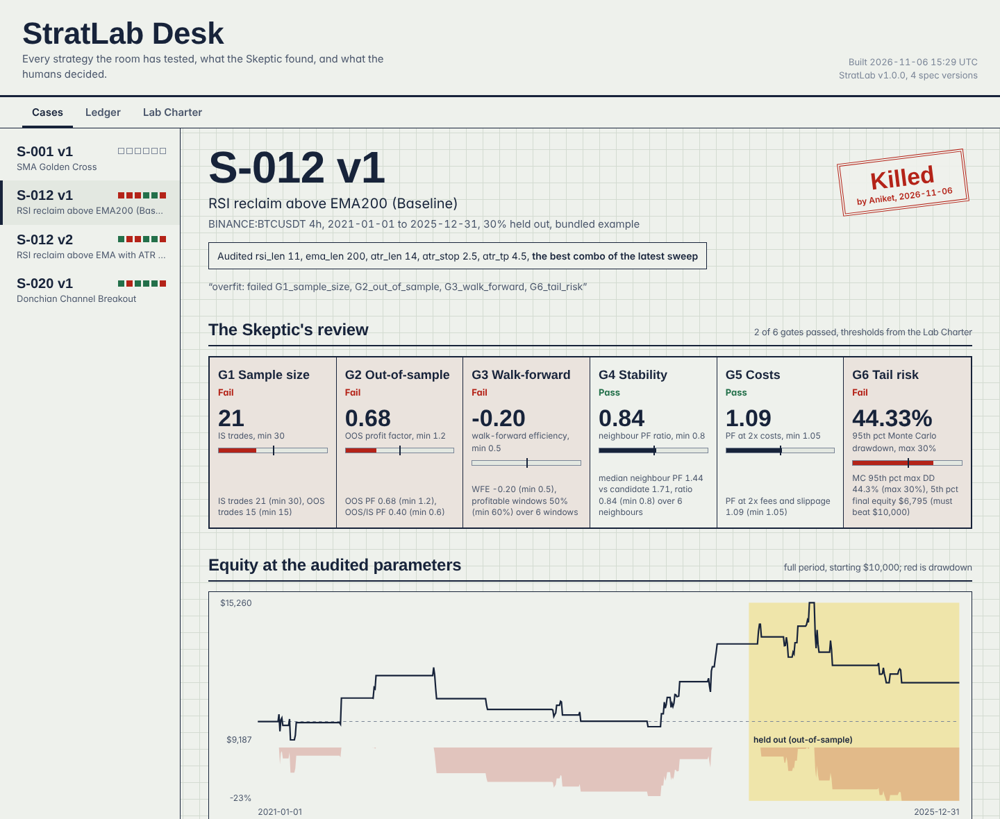
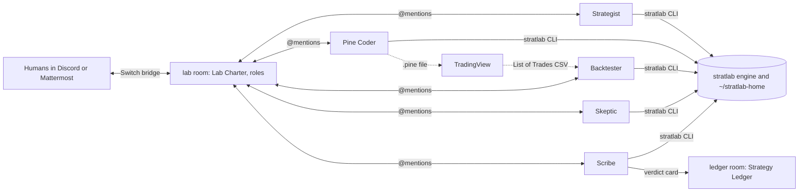

# StratLab

> Describe a strategy in plain English in your team chat. A desk of five agents writes it as a spec, codes it in Pine Script, backtests and optimises it, then tries to break it. You and your friends decide whether it lives.

[](https://github.com/ADITYASINGH1206/stratlab/actions/workflows/ci.yml)
[](LICENSE)
[](https://www.python.org/downloads/)
[](https://www.wemakedevs.org/hackathons/switch)


StratLab turns a Discord channel, or the Mattermost that ships with Switch, into a trading-strategy research desk. Five agents (Strategist, Pine Coder, Backtester, Skeptic and Scribe) share one Switch room with human traders. Every idea goes through the same loop: idea, spec, Pine Script and Python backtest, optimisation, an adversarial review against six promotion gates, and a human verdict.



*The StratLab Desk (`stratlab ui`): an offline page with every case the room has reviewed. This is S-012 v1 on the bundled data, killed by a human after failing four gates.*

StratLab is a research and testing tool. It never places orders, and nothing it prints is financial advice.

## What Switch does here

Without Switch, this is one chatbot. With it, it's a desk where agents check each other's work and humans hold the decision.

| Switch feature | How StratLab uses it |
| :--- | :--- |
| Shared room, several agents | Five agents in `#lab` hand work to each other by @mention. The Skeptic can attack the Backtester's result only because it reads the same thread. |
| Human in the loop | Agents recommend. Only a human message containing `promote`, `kill` or `park` ends a thread. |
| Room documents | **Lab Charter** (the protocol and the six gate thresholds, generated from the same YAML the code reads) and **Strategy Ledger** (rewritten by the Scribe after every verdict). |
| Roles | The Backtester takes the exclusive `quant-on-call` role, so "can someone run numbers on X" has an owner. |
| Room group and links | `#lab` and `#ledger` form the StratLab group; the link carries verdicts from one to the other. |
| Aliases | Agents are created as `stratlab-skeptic` and friends; the room maps them to short handles like `@skeptic`. |
| Attachments | `.pine` files, equity and heatmap PNGs, the desk HTML, and TradingView trade exports move through the chat. |
| Template | `switch/stratlab.template.yaml` creates all five agents, both rooms, the role and the documents in one step, then posts a kickoff. |
| Bridges | Discord for the demo, the bundled Mattermost as the reproducible default. |

## How it works



Each agent is a coding-agent session run by Switch Console (Claude Code by default; Antigravity, Codex and OpenCode are offered in the template's provider list). The agents never do arithmetic in their heads: every number they post is printed by the `stratlab` CLI and carries a run id. All five share `~/stratlab-home`, so a spec the Strategist writes is the file the Backtester tests.

One idea, end to end:

1. **Strategist** writes `~/stratlab-home/specs/S-031/v1.yaml` with `stratlab spec new`, validates it, posts a summary, and hands off.
2. **Pine Coder** runs `stratlab pine S-031@v1` and attaches the generated Pine v6. **Backtester**, in parallel, runs `backtest`, `sweep`, `walkforward` and `chart`.
3. **Skeptic** runs `stratlab gates S-031@v1`. It audits the *candidate*, the sweep's best in-sample combo, because that is the version a trader would actually ship. On FAIL it hands back to the Strategist, who may make at most three versions before waiting for a human.
4. A **human** replies `promote`, `kill` or `park`. **Scribe** records it, updates the Strategy Ledger document, posts a card in `#ledger`, and attaches the desk page.

## What the bundled data shows

These are the results on `sample_data/BTCUSDT_4h_2021_2025.parquet` (Binance BTCUSDT 4h, Jan 2021 to Dec 2025, the last 30% held out), after `stratlab sweep <ref> --budget 200` and `stratlab gates <ref>`:

| Spec | Candidate (sweep best) | IS PF / trades | OOS PF / trades | Gates passed | Failed |
| :--- | :--- | ---: | ---: | :---: | :--- |
| S-001 v1 SMA golden cross | fast_len 20, slow_len 100 | 1.48 / 47 | 1.45 / 21 | 5 of 6 | G6 |
| S-012 v1 RSI reclaim above EMA200 | rsi_len 11, atr_stop 2.5, atr_tp 4.5 | 1.71 / 21 | 0.68 / 15 | 2 of 6 | G1, G2, G3, G6 |
| S-012 v2 EMA cross with RSI filter | atr_stop 1.0, atr_tp 3.5 | 1.71 / 52 | 0.80 / 21 | 3 of 6 | G2, G3, G6 |
| S-020 v1 Donchian breakout | donchian_len 40, atr_stop 1.0 | 1.62 / 89 | 1.18 / 43 | 4 of 6 | G2, G6 |

Nothing passes all six gates, and that is the point. S-012 v1 looks good in-sample (profit factor 1.71) and loses money on the held-out data (0.68). Its walk-forward efficiency is negative and it has too few trades. S-012 v2 fixes the sample size but still degrades out of sample. With 100% of equity in every trade, the Monte Carlo drawdown gate (G6, at most 30%) is the hardest to clear. These numbers come straight from the engine; re-run `make demo` to reproduce them.

## Quickstart C: the engine alone, no Switch (2 minutes)

Needs Python 3.11+ and `make`. No API keys, no network after install.

```bash
git clone https://github.com/ADITYASINGH1206/stratlab && cd stratlab
make setup          # virtualenv, editable install, ~/stratlab-home, and the agents' CLI shim
make demo           # replays the #lab room offline with real numbers, then builds the desk
open ~/stratlab-home/artifacts/stratlab-desk.html    # xdg-open on Linux
```

`make demo` prints what each agent would post for S-012 v1 and v2, records a scripted human verdict in the ledger, and writes the desk page. It is the judges' smoke test. CI runs it on every push.

## Quickstart A: the full lab on Switch's local Mattermost (about 15 minutes)

1. Install Docker and [Switch Console](https://docs.switchagents.ai/switch-rooms/getting-started), start a local server, and sign in to Claude Code (`claude auth login`). Any provider from the template's list works if it is installed and signed in.
2. In this repo: `make setup`. This creates `~/stratlab-home/bin/stratlab`, the path every agent calls.
3. In Switch Console, open Templates and create from `switch/stratlab.template.yaml`. Pick the bundled Mattermost as the bridge. This creates the five agents, the `stratlab-lab` and `stratlab-ledger` rooms, the `quant-on-call` role, and the Lab Charter document, then posts a kickoff that asks each agent to introduce itself and runs S-001 end to end.
4. In `stratlab-lab`, post an idea:

   ```text
   @strategist idea: BTCUSDT 4h, long when RSI(14) crosses above 30 and close > EMA(200). Stop 2xATR(14), target 3xATR.
   ```

## Quickstart B: Discord

Follow [Switch's Discord guide](https://docs.switchagents.ai/flintai/switch/deploy/messaging-apps/discord). The bot needs the **Message Content** and **Server Members** intents and these permissions: View Channels, Send Messages, Send Messages in Threads, Manage Webhooks, Manage Channels, Manage Roles, Read Message History, Attach Files. Connect it in Switch with your Guild ID, then do step 3 above and pick Discord as the bridge. Each agent posts through a webhook under its own name.

## Commands

All commands print short text for chat; add `--json` for machine-readable output. A failure prints one `Error:` line and exits 1.

| Command | What it does |
| :--- | :--- |
| `stratlab spec new [--name ...] [--from S-012@v1]` | Create the next spec, or the next version of one, in the shared workspace |
| `stratlab spec validate / path / list / diff / schema` | Check, find, list and compare specs |
| `stratlab backtest S-012@v1 [--params k=v,...]` | In-sample and out-of-sample backtest |
| `stratlab sweep S-012@v1 --budget 200` | Grid or seeded random search on in-sample only; the best combo with enough trades becomes the candidate |
| `stratlab walkforward S-012@v1` | 24-month fit, 6-month blind test, rolled every 6 months |
| `stratlab robust S-012@v1` | Monte Carlo, 2x costs, and one-step parameter neighbours on the candidate |
| `stratlab gates S-012@v1 [--set section.key=value] [--strict]` | The six gates. Exit code 0 even on FAIL (a verdict, not an error); `--strict` exits 1 for CI |
| `stratlab chart S-012@v1` | `equity.png`, `heatmap.png`, `walkforward.png`, `card.png` |
| `stratlab pine S-012@v1` / `stratlab pine import file.pine` | Generate Pine v6 / reverse-map simple Pine into a spec draft |
| `stratlab parity S-012@v2 trades.csv` | Compare with a TradingView List of Trades export |
| `stratlab ledger add / render / query / digest` | Verdicts, the ledger document, history, weekly digest |
| `stratlab ui [--serve]` | Build the StratLab Desk page (optionally serve it on localhost) |
| `stratlab demo` | The offline room replay |
| `stratlab data fetch BTCUSDT 4h --from 2021-01-01` | Fresh data from Binance via ccxt (no key), yfinance fallback |

## The StrategySpec

One YAML file is the single source of truth. It compiles to the Python engine and to Pine Script v6.

```yaml
id: S-012
version: 1
name: RSI reclaim above EMA200 (Baseline)
market: { symbol: BTCUSDT, exchange: binance, tv_symbol: "BINANCE:BTCUSDT", timeframe: 4h }
period: { start: 2021-01-01, end: 2025-12-31, oos_fraction: 0.3 }
direction: long
params:
  rsi_len:  { default: 9, range: [7, 21, 2] }      # tunable: the sweep varies it
  ema_len:  { default: 200, fixed: true }          # fixed: never optimised
  atr_len:  { default: 14, fixed: true }
  atr_stop: { default: 2.0, range: [1.0, 3.0, 0.5] }
  atr_tp:   { default: 3.0, range: [2.0, 5.0, 0.5] }
indicators:
  rsi: { fn: rsi, src: close, len: $rsi_len }
  ema: { fn: ema, src: close, len: $ema_len }
  atr: { fn: atr, len: $atr_len }
entry:
  long: { all: [ { crosses_above: [rsi, 30] }, { gt: [close, ema] } ] }
exit:
  stop:   { atr_mult: $atr_stop }
  target: { atr_mult: $atr_tp }
  time:   { bars: 60 }
```

**Supported in v1:**

- **Indicators:** `sma`, `ema`, `wma`, `rma`, `rsi`, `atr`, `highest`, `lowest`, `expr` (arithmetic on series, for example `atr / close * 100`).
- **Conditions:** `gt`, `lt`, `gte`, `lte`, `eq`, `neq`, `crosses_above`, `crosses_below`, `all`, `any`, `not`, and `name[n]` bar offsets.
- **Exits:** ATR or percent stop and target, time exit, and opposite signal (an `entry.short` condition that closes the long).

Anything else (short selling, MACD, Bollinger Bands, multi-timeframe data) is rejected by `spec validate` with a message that says what is supported. Unknown keys are errors too, so a typo like `stopp:` is reported instead of silently ignored.

## The six gates (Lab Charter)

| Gate | Passes when |
| :--- | :--- |
| G1 Sample size | At least 30 in-sample and 15 out-of-sample trades |
| G2 Out-of-sample | OOS profit factor at least 1.2, and OOS PF / IS PF at least 0.6 |
| G3 Walk-forward | Walk-forward efficiency at least 0.5 and at least 60% of blind windows profitable |
| G4 Stability | Median in-sample PF of the one-step neighbours at least 0.8x the candidate's |
| G5 Costs | Full-period PF at least 1.05 with 2x commission and slippage |
| G6 Tail risk | Over 1,000 Monte Carlo reshuffles: 95th percentile drawdown at most 30%, and 5th percentile ending equity above the starting capital |

These are reasonable starting values, not industry standards. They live in `~/stratlab-home/charter.yaml`. Edit them there, or override one for a single review with `stratlab gates S-012@v1 --set g2_out_of_sample.min_oos_pf=1.3`. The Lab Charter room document is generated from the same file, so the Skeptic's labels always match the code. Walk-forward efficiency is the mean annualised out-of-sample return divided by the mean annualised in-sample return.

## Execution model and TradingView parity

The engine copies TradingView's broker emulator with default settings:

- Signals are evaluated on bar close. Market orders fill at the next bar's open, plus slippage.
- An entry is only placed if the strategy was flat at the signal bar's close, so a trade stopped out intrabar is never refilled at that bar's open.
- Stop and target are set from the fill price and the signal bar's ATR, and become active on the next bar.
- Intrabar path: if the open is nearer the high, open, high, low, close; otherwise open, low, high, close. Gaps fill at the open.
- Slippage applies to market and stop fills; limit (target) fills get none. Commission is a percentage per side.
- Indicators match Pine: RSI and ATR use Wilder's RMA, and EMA is seeded with an SMA. They are computed on the whole history, so the out-of-sample window keeps its warm-up.

The generated Pine follows the same rules. To check parity:

1. Run `stratlab pine S-012@v2` and paste the file into TradingView on `BINANCE:BTCUSDT`, 4h.
2. Set the chart timezone to UTC and keep Bar Magnifier off.
3. In Strategy Tester, export List of Trades to CSV.
4. Run `stratlab parity S-012@v2 trades.csv`, or attach the CSV in `#lab` with `@backtester parity S-012@v2`.

The report shows matched entries within one bar (target at least 95%), net-profit drift (target within 5%), and the first mismatching trade side by side. **Status: parity has not yet been measured against a real TradingView export.** The repo's test suite checks the matcher and the CSV parser (including the current `Net P&L` and `Position size (qty)` headers), not TradingView itself. Known causes of drift: TradingView's data feed vs the cached candles, TradingView sizing 100% of equity from the signal bar's close rather than the fill price, the intrabar path assumption, the chart timezone, and tick rounding.

## Limitations

- Long only, one position at a time, 100% of equity per trade.
- The Pine vocabulary is deliberately small; that is what makes parity achievable.
- The demo's human verdicts are scripted. Agent behaviour depends on the model and on the prompts in `switch/agents/`.
- The loop guard (at most three versions without a human) is enforced by the Strategist's instructions, not by code.
- One bundled dataset. Gates on one market and one period do not remove the risk that an idea only worked there.

## Repository layout

```text
stratlab/            Python package and CLI
  engine/            indicators, conditions, Numba sim, runner, metrics, registry, ledger
  research/          sweep, walk-forward, robustness, gates, charter
  pine/              Pine v6 generator and importer
  tv/                TradingView CSV parser and parity
  ui/                the StratLab Desk page (stratlab ui)
  demo.py            the offline room replay
switch/              agent and room instructions (Markdown), template builder, generated template
examples/specs/      S-001, S-012 v1 and v2, S-020
sample_data/         Binance BTCUSDT 4h, 2021 to 2025
fixtures/            golden Pine files, a TradingView CSV format sample
tests/               pytest suite (isolated STRATLAB_HOME)
```

Edit agent instructions in `switch/agents/*.md` and run `make template`; CI fails if the generated YAML is out of date. `make test` and `make lint` run the suite and ruff.

## License and thanks

MIT. Built for [Flip the Switch](https://www.wemakedevs.org/hackathons/switch) by WeMakeDevs and DevTools Academy, on [Switch](https://github.com/sandbox-quantum/switch). Not financial advice.
